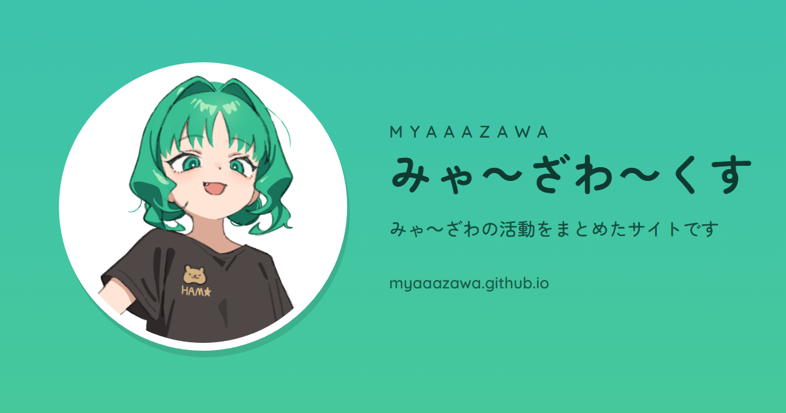
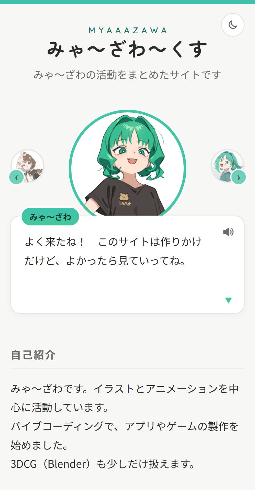

  

[日本語](#日本語) | [English](#english)

---

## 日本語

みゃ～ざわの活動をまとめたサイトです。
イラスト・アニメーションを中心に、自分で作ったアプリの紹介や、SNSへのリンクを載せています。

**サイトを開く：** https://myaaazawa.github.io/

### 画面

### サイトの内容

- **アバターとの会話**：キャラクターに話しかけると、選択肢で会話ができます。
  - 左右の丸いボタンで、ほかのキャラクターに切り替えられます。
  - 2人のキャラクターが並んで話す会話もあります。
  - 文字送りに合わせて、小さな効果音が鳴ります（音のオン・オフを切り替えられます）。
- **自己紹介**
- **アプリ**：自分で作ったアプリの紹介と、アプリへのリンク
- **リンク**：X、Xfolio、GitHub、Bluesky
- ライトモード／ダークモードの切り替え（右上のボタン）
- パソコン・タブレット・スマートフォンに対応

### イラスト・キャラクターについて

- このサイトで使っているキャラクターとイラストの権利は、すべて作者（みゃ～ざわ）にあります。
- イラストや画像の無断転載・再配布・改変はご遠慮ください。
- すずの紹介は、本人の許可を得て掲載しています。

### 使わせてもらっているもの

- フォント：[Zen Maru Gothic](https://fonts.google.com/specimen/Zen+Maru+Gothic)、[Quicksand](https://fonts.google.com/specimen/Quicksand)（Google Fonts、SIL Open Font License）
- 引用：宮沢賢治『銀河鉄道の夜』（[青空文庫](https://www.aozora.gr.jp/)より。底本：岩波文庫、岩波書店）

### データとプライバシー

- ライト／ダークの選択と、音のオン・オフの選択は、お使いのブラウザの中（ローカルストレージ）だけに保存されます。
- このサイトが、見ている人の情報を集めることはありません。アクセス解析や広告も使っていません。
- タイトルの文字を表示するために、Google Fonts からフォントを読み込んでいます。このとき、お使いのブラウザが Google のサーバーに接続します。

### 無保証・免責

- このサイトは、現状のまま提供しています。内容の正確さについて、いかなる保証もしません。
- このサイトの利用によって生じた損害について、作者は責任を負いません。
- 内容は、予告なく変更・公開停止することがあります。

### 利用条件

- ライセンスは設定していません。著作権は作者に帰属します。
- GitHub の利用規約で認められている範囲（閲覧など）を除き、プログラムや画像の無断での転載・再配布・改変はご遠慮ください。

### 作者

みゃ～ざわ

- X：[@Miyazawa2020](https://x.com/Miyazawa2020)
- Xfolio：[myaaazawa](https://xfolio.jp/portfolio/myaaazawa)
- Bluesky：[@myaaazawa.bsky.social](https://bsky.app/profile/myaaazawa.bsky.social)
- GitHub：[myaaazawa](https://github.com/myaaazawa)

---

## English

> **Note:** This English version was translated with the help of AI and may contain inaccuracies.
> If anything differs from the Japanese version, the Japanese version takes precedence.
> （英語版は AI による翻訳のため、正確でない表現が含まれている可能性があります。内容に違いがある場合は、日本語版を優先します。）

みゃ～ざわ～くす (Myaaazawa's website) brings together the activities of Myaaazawa.
It focuses on illustration and animation, and also introduces apps I have made and links to my social media.

**Open the site:** https://myaaazawa.github.io/

### Screenshot

### What's on the site

- **Talk with the avatars**: Talk to a character and choose what to say from the options.
  - Use the round buttons on the left and right to switch to other characters.
  - Some conversations have two characters talking side by side.
  - Soft sound effects play as the text appears (you can turn the sound on or off).
- **About me**
- **Apps**: Apps I have made, with links to open them
- **Links**: X, Xfolio, GitHub, Bluesky
- Light / dark mode switch (button at the top right)
- Works on computers, tablets and smartphones

### About the illustrations and characters

- All rights to the characters and illustrations used on this site belong to the author (Myaaazawa).
- Please do not copy, redistribute or modify the illustrations or images without permission.
- Suzu appears on this site with her own permission.

### Credits

- Fonts: [Zen Maru Gothic](https://fonts.google.com/specimen/Zen+Maru+Gothic), [Quicksand](https://fonts.google.com/specimen/Quicksand) (Google Fonts, SIL Open Font License)
- Quotation: Kenji Miyazawa, *Night on the Galactic Railroad* (from [Aozora Bunko](https://www.aozora.gr.jp/); source text: Iwanami Bunko, Iwanami Shoten)

### Data and privacy

- Your light / dark choice and your sound on / off choice are saved only in your browser (local storage).
- This site does not collect any information about visitors. It uses no analytics and no ads.
- To display the title lettering, the site loads fonts from Google Fonts. When it does, your browser connects to Google's servers.

### No warranty

- This site is provided as is, without any warranty of any kind as to the accuracy of its content.
- The author is not responsible for any damage caused by using this site.
- The content may be changed or taken down without notice.

### Terms of use

- No license is granted. The author retains the copyright.
- Except as allowed by GitHub's Terms of Service (such as viewing), please do not copy, redistribute or modify the code or images without permission.

### Author

Myaaazawa

- X: [@Miyazawa2020](https://x.com/Miyazawa2020)
- Xfolio: [myaaazawa](https://xfolio.jp/portfolio/myaaazawa)
- Bluesky: [@myaaazawa.bsky.social](https://bsky.app/profile/myaaazawa.bsky.social)
- GitHub: [myaaazawa](https://github.com/myaaazawa)
